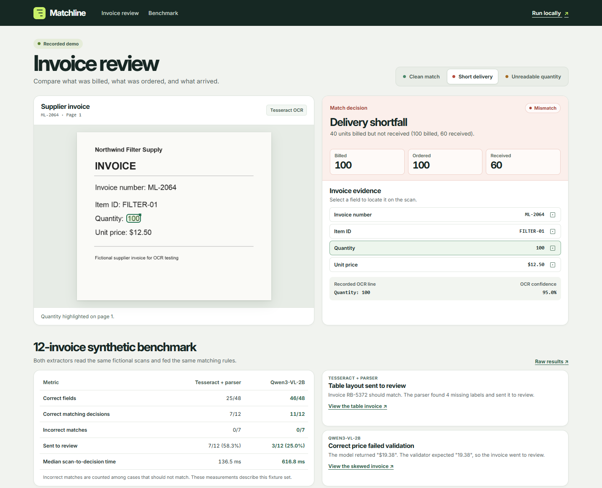

# Matchline

Matchline compares one item across a supplier invoice, a purchase order, and a delivery receipt. It reports its decision, the reason, and the values read from each document. See [the project roadmap](docs/PROJECT.md) for the full invoice auditor.

## Recorded demo on Windows

From PowerShell, check out the demo branch and start a local server from the repository root.

```powershell
git clone --branch milestone-4-demo --single-branch https://github.com/akaAdiArun/matchline.git
cd matchline
python -m http.server 8000 --bind 127.0.0.1
```

If you already have the demo branch checked out, run just the server command. Open [the local demo](http://127.0.0.1:8000/demo/) in a browser. The demo uses recorded pipeline outputs and runs with Python alone. Select a case, then click an extracted field to highlight its OCR location when one is available.



The demo loads the [original benchmark results](evaluation/results.json) for its comparison. To regenerate the three recordings after [setting up the real OCR pipeline](#match-a-scanned-invoice-on-windows), run `python -m demo.record` from the repository root. The bundled Inter font is covered by the [SIL Open Font License](demo/fonts/OFL.txt).

Start with [matching.py](matching.py) for the decision rules and [invoice_ocr.py](invoice_ocr.py) for scan extraction. [matchline.py](matchline.py) connects the two and prints the result as JSON.

## Run the examples

Run these commands from the repository root with Python 3. No third-party packages are required.

```sh
python -m matchline examples/invoice.json examples/purchase-order.json examples/receipt.json
python -m matchline examples/invoice.json examples/purchase-order.json examples/receipt-short.json
python -m matchline examples/invoice-price-mismatch.json examples/purchase-order.json examples/receipt.json
python -m matchline examples/invoice-unreadable.json examples/purchase-order.json examples/receipt.json
```

| Command | Expected status | Evidence |
| --- | --- | --- |
| First | `matched` | All three documents show 100 units, and the invoice and order both show a unit price of 12.50. |
| Second | `mismatch` | 100 billed and 60 received, leaving 40 units billed but not received. |
| Third | `mismatch` | Invoice unit price 13.25 and purchase order unit price 12.50. |
| Fourth | `needs_review` | The invoice quantity is `null`. |

To try the receipt change, run the second command, then change its last argument to `examples/receipt.json` and run it again. The only difference between the two receipt files is their quantity, which goes from 60 to 100. The result changes from `mismatch` to `matched`.

## Match a scanned invoice on Windows

Install the x64 Tesseract build with English language data from PowerShell. The scan examples were verified with Tesseract 5.5.0. The package comes from the [Tesseract release](https://github.com/tesseract-ocr/tesseract/releases/tag/5.5.0).

```powershell
winget install --exact --id tesseract-ocr.tesseract --version 5.5.0.20241111 --source winget --interactive
$env:MATCHLINE_TESSERACT = 'C:\Program Files\Tesseract-OCR\tesseract.exe'
& $env:MATCHLINE_TESSERACT --version
& $env:MATCHLINE_TESSERACT --list-langs
```

Keep English selected in the installer and check that `--list-langs` includes `eng`. If you installed Tesseract in a different directory, set `MATCHLINE_TESSERACT` to that executable. Matchline also accepts `tesseract` on PATH when the variable is unset. The Python code uses the standard library.

Run these commands from the repository root in the same PowerShell session. Only the invoice input changes to an image.

```powershell
python -m matchline --invoice-image examples/scans/clean.png examples/purchase-order.json examples/receipt.json
python -m matchline --invoice-image examples/scans/short-delivery.png examples/purchase-order.json examples/receipt-short.json
python -m matchline --invoice-image examples/scans/unreadable-quantity.png examples/purchase-order.json examples/receipt.json
```

| Scan | Expected status | Evidence |
| --- | --- | --- |
| Clean | `matched` | Invoice ML-1048 bills 100 units at 12.50. |
| Short delivery | `mismatch` | Invoice ML-2064 bills 100 units and the receipt shows 60, a shortfall of 40. |
| Obscured quantity | `needs_review` | The quantity on invoice ML-3192 is covered by an opaque rectangle. |

The result includes `invoice_extraction` with observations for the invoice number, item ID, quantity, and unit price. Each observation stores the OCR text, bounding boxes for the value and full line when available, and the lowest confidence among the words in the value. Coordinates use pixels from the image's top left and page numbering starts at 1. If OCR only reads the label, its line location remains available while the value and its location are `null`.

In the verified run on the obscured scan, Tesseract read `Quantity:` without a value. It also read `FILTER-01` correctly at a confidence of 60.55, below the acceptance threshold of 80. Matchline preserved the item text and its box as evidence, marked both fields unresolved, and returned `needs_review`.

To see Tesseract's original word rows directly, run this command.

```powershell
& $env:MATCHLINE_TESSERACT examples/scans/clean.png stdout -l eng --psm 6 tsv
```

The scan parser expects one upright English page with one line item and one each of the labels `Invoice number:`, `Item ID:`, `Quantity:`, and `Unit price:`. It expects each value on the same line as its label. IDs can contain letters, digits, hyphens, and underscores. Quantities are whole numbers. Prices accept an optional dollar sign and up to two decimal places. Missing labels, conflicting or repeated labels, invalid text, and word confidence below 80 leave the value unresolved. An unresolved invoice number also requires review so the decision can be tied to a specific invoice. OCR confidence is a heuristic and can miss recognition errors. This baseline supports the supplied scan layout. More complex layouts, handwriting, and image cleanup are outside its scope.

## Run the tests

```sh
python -m unittest discover -s tests -v
```

The scan tests run the installed Tesseract against the checked-in PNGs, including a separate scan where only the quantity is obscured. They are skipped if the executable is unavailable. The matching and parser tests run independently.

## Compare Tesseract and local vision

The small synthetic evaluation compares the existing OCR parser with Qwen3-VL-2B on 12 held-out images. See the [benchmark setup, results, and failure examples](evaluation/README.md) for the Windows commands and per-document evidence.

## Input and decision rules

Pass three UTF-8 JSON objects as separate files in invoice, purchase order, delivery receipt order. Each object represents one line item and has an `item_id` (a nonblank string) and a `quantity` (a non-negative JSON integer). The invoice and purchase order also have a `unit_price` (a finite, non-negative JSON number). The two prices are assumed to be in the same currency. The program compares prices exactly and prints them as decimal strings.

All item IDs and quantities must agree, and the invoice unit price must equal the purchase order unit price. A missing, null, or invalid required value takes precedence and returns `needs_review`. The result keeps that value as `null` and identifies the affected field. The CLI exits successfully for any of the three decisions. A file it cannot read, invalid JSON, or a top-level value other than an object is a command error.

## Contact

Adithyakrishna Arunkumar · [adithyakrishna10000@gmail.com](mailto:adithyakrishna10000@gmail.com)
